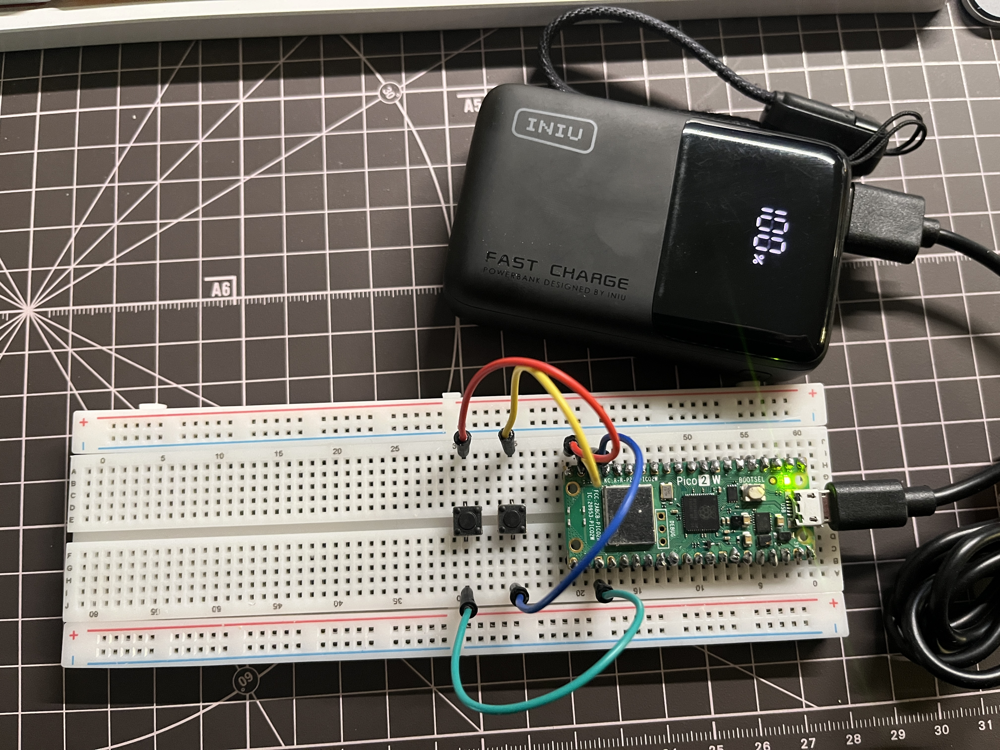
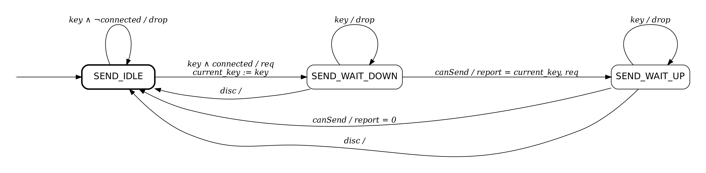

# Pico Page Turner

A Bluetooth Low Energy (BLE) page turner built on a Raspberry Pi Pico 2 W, written in C with the official Pico SDK and BTstack.



The Pico presents itself as a standard BLE HID keyboard. Pressing a button sends an arrow key, which phones and e-readers interpret as "next page" or "previous page". No app or driver is needed on the receiving device.

Tested with an iPhone and a Kobo e-reader.

## Features

- BLE HID keyboard (HID over GATT), pairs like any Bluetooth keyboard
- Two buttons: **Next** sends Right Arrow, **Prev** sends Left Arrow
- Interrupt-driven button input with 30 ms debounce
- CPU sleeps between events (`best_effort_wfe_or_timeout`, built on `__wfe`) instead of busy polling
- Status LED: blinking while advertising, solid when connected
- Bonding: pairing info is stored in flash, so paired devices reconnect automatically

## Hardware

| Part | Notes |
|---|---|
| Raspberry Pi Pico 2 W | RP2350 + CYW43439 wireless chip |
| 2 tactile push buttons | 2-pin momentary |
| Breadboard and jumper wires | |

### Wiring

Each button connects a GPIO to GND. The internal pull-up resistors are enabled in software, so no external resistors are needed (active-low).

| Button | GPIO | Physical pin | Other leg |
|---|---|---|---|
| Next | GP14 | 19 | GND (pin 18) |
| Prev | GP15 | 20 | GND (pin 23) |

## Software Architecture

```
page_turner.c        Application: button input, debounce, LED, main loop
ble_keyboard.c/.h    BLE HID keyboard module: advertising, pairing, GATT, key sending
page_turner.gatt     GATT database (compiled to page_turner.h at build time)
btstack_config.h     BTstack configuration
```

`page_turner.c` decides **which** key to send. `ble_keyboard.c` handles **how** to send it over BLE. The module exposes three functions:

```c
void ble_keyboard_init(void);
bool ble_keyboard_is_connected(void);
bool ble_keyboard_send_key(uint8_t keycode);
```

### Button input

1. A GPIO edge triggers `gpio_isr`, which disables that pin's interrupt and schedules a 30 ms alarm.
2. When the alarm fires, `debounce_done` reads the settled pin level. On a new press it sets an event flag and wakes the CPU with `__sev()`.
3. The main loop wakes from `best_effort_wfe_or_timeout` (a `__wfe` with a 250 ms timeout so the LED can keep blinking), sees the flag, and calls `ble_keyboard_send_key()`.

ISRs only set `volatile` flags. Slow or locking work such as `printf`, BLE calls, and LED control stays in the main loop.

### Key sending state machine

One key press needs two HID reports (key down, then key up), and BTstack only allows sending when it signals `HIDS_SUBEVENT_CAN_SEND_NOW`. A three-state machine tracks progress between those callbacks:



- **Inputs:** `key` (send request from main), `canSend` (BTstack ready to send), `disc` (disconnected)
- **Outputs:** `req` (request a send slot), `report` (send HID report), `drop` (request rejected)

### Concurrency

BTstack runs in a low-priority background interrupt via the SDK's `async_context`, and holds its lock while doing so. `ble_keyboard_send_key()` is called from the main loop and modifies the same state (`send_state`, `con_handle`), so it acquires the same lock:

```c
async_context_acquire_lock_blocking(ctx);
/* check state, update state, request send */
async_context_release_lock(ctx);
```

This keeps the check-then-update sequence atomic. If a disconnect event arrives while main holds the lock, the SDK defers it until the lock is released, so the state machine always ends in a consistent state.

## Build and Flash

### Requirements

- Pico SDK 2.x (developed with 2.3.1)
- VS Code with the **Raspberry Pi Pico** extension

### Build with VS Code

1. Open the folder with the Raspberry Pi Pico extension (**Import Project**).
2. Select board **pico2_w**.
3. Click **Compile**.

### Flash

1. Hold **BOOTSEL** while plugging in USB, then release it.
2. Copy `build/page_turner.uf2` to the `RP2350` drive. The board reboots automatically.

## Usage

1. Power on. The LED blinks while advertising.
2. Pair **Pico PageTurner** from the Bluetooth settings of your phone or e-reader.
3. The LED turns solid once the host subscribes to key reports.
4. Press **Next** or **Prev** to turn pages.

USB serial output (115200 baud) shows pairing and key events for debugging.

## Known Limitations

- **iOS hides the on-screen keyboard** while any keyboard is connected. Disconnect the page turner to type.
- **One host at a time.** Disconnect from one device before pairing another.
- A press is dropped if the previous key is still being sent (about 30 to 60 ms).
- Battery level is reported as a fixed 100%.

## Roadmap

- [ ] Battery power (3 x AAA with a Schottky diode on VSYS)
- [ ] Power optimization: advertising interval, connection parameters, sleep modes
- [ ] Key queue to avoid dropped presses
- [ ] Optional long-press or chord actions

## Credits and License

- `ble_keyboard.c` is derived from the BTstack example
  [`hog_keyboard_demo.c`](https://github.com/bluekitchen/btstack/blob/master/example/hog_keyboard_demo.c),
  Copyright (C) 2014 BlueKitchen GmbH. It is distributed under the original BlueKitchen license, which permits
  redistribution and modification for **non-commercial use only**. See the notice at the top of the file.
- `pico_sdk_import.cmake` is from the Raspberry Pi Pico SDK (BSD-3-Clause).
- HID descriptor layout: USB HID Specification 1.1, Appendix B.1. Key codes: USB HID Usage Tables, Keyboard/Keypad Page (0x07).